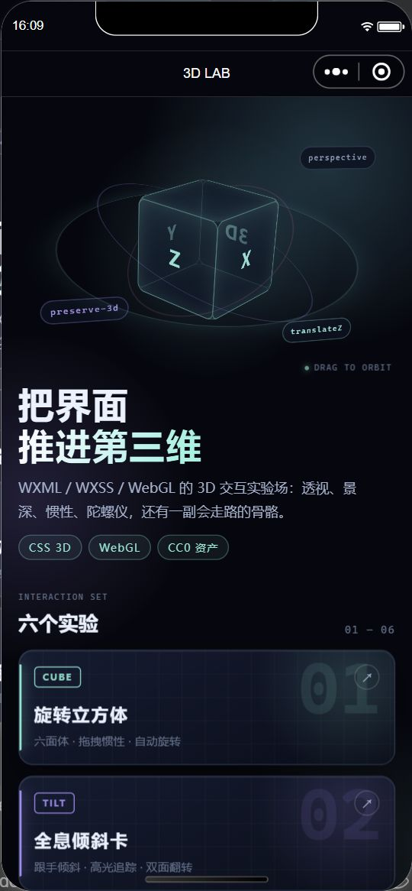
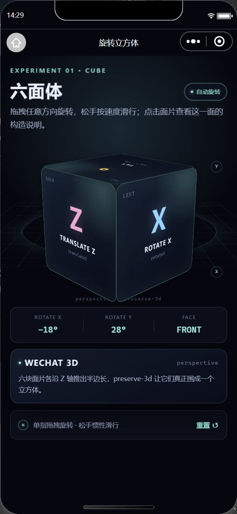
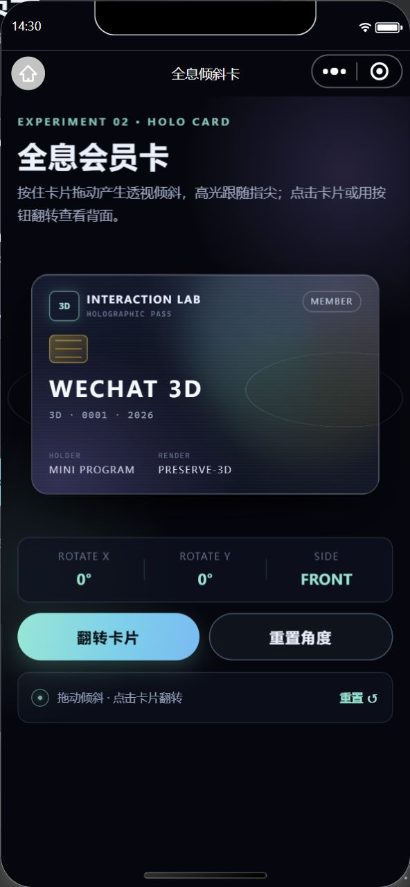
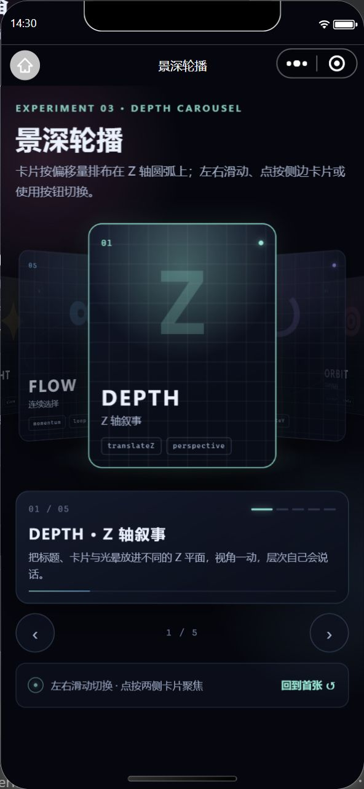
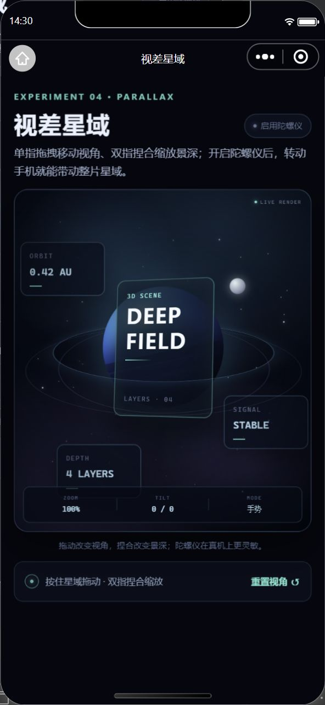
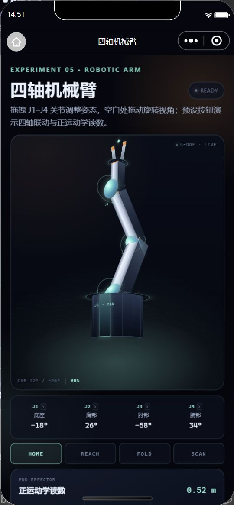
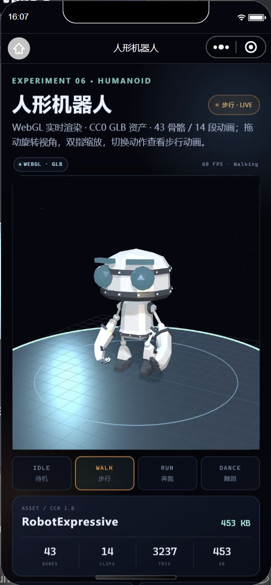

# 3D LAB · 微信小程序 3D 交互实验场

<p align="center">
  
</p>

<p align="center">
  <a href="https://github.com/Tianjian/wechat-miniapp-3d-lab/actions/workflows/verify.yml"></a>
  <a href="LICENSE"></a>
  
  
  = 18" />
</p>

一个可以直接用微信开发者工具打开的原生小程序 3D 作品集：**5 个纯 CSS 3D 实验 + 1 个 WebGL 骨骼动画实验**，覆盖透视、景深、跟手倾斜、惯性、陀螺仪、四轴机械臂正运动学，以及一个会走路的人形机器人。

- **6 个实验页 + 1 个入口页**，全部为原生 WXML / WXSS / JS
- **零 npm 安装、零构建**：Three.js r108 小程序适配版、GLTFLoader 与 464 KB CC0 模型都已 vendor 到 `lib/`
- **离线运行**：人形机器人 GLB 以 base64 内联，运行时不发起网络请求，不受域名白名单影响
- **可验证**：静态检查 + mock 冒烟 + GLB 资产校验，一条命令跑完；CI 自动执行

## 实验一览

| 页面 | 交互 | 关键实现 |
| --- | --- | --- |
| [`pages/cube`](pages/cube/cube.wxml) 旋转立方体 | 拖拽旋转、松手惯性、点击面片、自动旋转 | 6 个 `translateZ` 面片 + `preserve-3d`，速度投影为惯性目标角 |
| [`pages/tilt`](pages/tilt/tilt.wxml) 全息倾斜卡 | 跟手倾斜、高光追踪、双面翻转 | 外层 `rotateX/rotateY` + 内层 `rotateY(180deg)`，径向渐变跟随触点 |
| [`pages/coverflow`](pages/coverflow/coverflow.wxml) 景深轮播 | 左右滑动、点按侧卡、循环选择 | 环形偏移 + `translateX/translateZ/rotateY/scale` 组成 Coverflow |
| [`pages/scene`](pages/scene/scene.wxml) 视差星域 | 单指平移、双指缩放、陀螺仪 | 多层 Z 深度 + 世界旋转；设备运动 API 失败时降级为手势 |
| [`pages/robot`](pages/robot/robot.wxml) 四轴机械臂 | 拖拽 J1–J4 关节、相机环绕、预设姿态、夹爪 | 嵌套 `preserve-3d` 关节链；正运动学实时计算末端坐标 |
| [`pages/humanoid`](pages/humanoid/humanoid.wxml) 人形机器人 | Idle / Walking / Running / Dance、环绕、缩放 | `<canvas type="webgl">` + three.js + GLTFLoader + `AnimationMixer` |

## 界面预览

> 截图来自微信开发者工具模拟器（不同机型宽度略有差异）。

| 首页 / 3D 主视觉 | 旋转立方体 |
| --- | --- |
|  |  |

| 全息倾斜卡 | 景深轮播 |
| --- | --- |
|  |  |

| 视差星域 | 四轴机械臂 |
| --- | --- |
|  |  |

| 人形机器人 · WebGL 步行 | |
| --- | --- |
|  | |

## 快速开始

环境：微信开发者工具（建议 2.02+），可选 Node.js 18+ 用于校验脚本。

```bash
git clone https://github.com/Tianjian/wechat-miniapp-3d-lab.git
cd wechat-miniapp-3d-lab
```

1. 用微信开发者工具「导入项目」，目录选择仓库根目录。
2. `project.config.json` 中的 `appid` 是 **`touristappid` 占位**。如需预览/上传，请替换为你自己的小程序 AppID；**不要把真实 AppID 提交回仓库**。
3. 运行校验：

```powershell
# Windows 快捷方式
.\tools\verify.cmd
.\tools\smoke.cmd

# 任意平台（Node 18+）
node scripts/verify.mjs
node scripts/smoke.mjs
```

4. 打开开发者工具：

```powershell
.\tools\dev.cmd open
```

> `touristappid` 下 CLI 的 `open --project` 会被开发者工具拒绝，脚本会降级为打开 IDE；在 IDE 中手动导入本目录即可。替换为真实 AppID 后，`preview` / `upload` 才可用。

## 验证结果

| 项目 | 结果 |
| --- | --- |
| 静态校验 | **22 通过 · 0 警告 · 0 失败** |
| mock 冒烟 | **15 / 15** |
| `preview` 构建 | **1.3 MB，无编译错误** |
| 包体积 | **1419.8 KB / 2048 KB** |
| 模拟器渲染 | 7 个页面正常，人形机器人 **60 FPS** |
| CI | GitHub Actions `verify.yml` |

校验覆盖：工程配置、页面/组件四件套、JS/JSON/WXML/WXSS 静态检查、路由与资源引用、mock 运行时、GLB magic/版本校验、主包体积。详见 [docs/VERIFICATION.md](docs/VERIFICATION.md)。

## 技术架构

### 纯 CSS 3D（5 个实验）

`app.json` 显式使用 WebView 渲染器；`perspective` + `transform-style: preserve-3d` + `translateZ` 构成立方体、卡片、轮播与星域。动态 `transform` 通过内联 style 驱动，触摸位移在 `utils/3d.js` 中换算为角度、动量与环形偏移。

机械臂是一条嵌套关节链：

```text
base yaw (rotateY)
└─ shoulder (translateY + rotateX)
   └─ elbow (translateY + rotateX)
      └─ wrist (translateY + rotateX)
         └─ gripper
```

`utils/robot.js` 用正运动学把 4 个关节角换算成末端 X/Y/Z、行程与百分比。

### WebGL 骨骼动画（人形机器人）

人形机器人页不是 WebView 网页，而是 `<canvas type="webgl">` 上的 scoped three.js：

- `lib/three.miniprogram.js`：`threejs-miniprogram` 0.0.8，`createScopedThreejs(canvas)` 绑定 canvas 与独立 THREE 命名空间
- `lib/gltf-loader.js`：three.js r108 GLTFLoader，包装为 `registerGLTFLoader(THREE)`
- `lib/robot-model.js`：464 KB GLB 的 base64 内联；`wx.base64ToArrayBuffer` 后交给 `loader.parse()`，绕开网络与本地文件路径
- `AnimationMixer` 播放 43 根骨骼的动画；相机用球坐标环绕；方向光阴影 + 环形舞台 + 自发光 visor
- 渲染循环由 `canvas.requestAnimationFrame` 驱动，模拟器稳定 60 FPS

更多细节见 [docs/ARCHITECTURE.md](docs/ARCHITECTURE.md)。

## 3D 资产与许可

人形机器人模型是 **[RobotExpressive](https://github.com/mrdoob/three.js/tree/dev/examples/models/gltf/RobotExpressive)**（three.js 官方示例资产）：

- 作者：Tomás Laulhé；修改：Don McCurdy
- 许可：**CC0 1.0**（公共领域）
- 规格：463,988 字节，43 骨骼，14 段动画（Idle / Walking / Running / Dance / Wave 等）

Three.js、threejs-miniprogram、GLTFLoader 均为 **MIT**。完整来源、版权与许可见 [`lib/LICENSES.md`](lib/LICENSES.md) 和 [docs/ASSETS.md](docs/ASSETS.md)。

## 目录结构

```text
.
├─ app.js / app.json / app.wxss     小程序入口、页面注册、全局设计变量
├─ project.config.json              开发者工具配置（appid = touristappid 占位）
├─ sitemap.json
├─ pages/                           7 个页面（首页 + 6 个实验）
├─ components/                      2 个自定义组件
├─ utils/                           3D / 机械臂 / 机器人纯函数与数据
├─ lib/                             Three.js 适配版、GLTFLoader、GLB、三方许可
├─ scripts/                         校验、冒烟、DevTools CLI
├─ tools/                           Windows 启动器（CRLF / ASCII）
├─ docs/                            架构、资产、验证文档与截图
├─ .github/workflows/verify.yml     CI
├─ README.md / LICENSE / SECURITY.md / CONTRIBUTING.md / CHANGELOG.md
└─ package.json
```

## 安全说明

- 仓库中**不包含**真实微信 AppID、上传密钥、GitHub Token 或任何 `.env` 文件。
- `project.config.json` 使用 `touristappid` 占位；本地真实 AppID 建议只改工作区，不要提交。
- `project.private.config.json`、`node_modules/`、`miniprogram_npm/` 等已在 `.gitignore` 中忽略。
- 发现安全问题请通过 GitHub 私密漏洞报告渠道联系，详见 [SECURITY.md](SECURITY.md)。

## 已知边界

- 人形机器人步行是**原地循环动画 + 环形舞台**，不包含位移路径、碰撞或 IK；模型是 CC0 低多边形风格。
- WebGL 页需要设备支持 WebGL；低端机的 GPU 性能与阴影开销需真机确认。
- 前五个实验是 CSS 3D `view`；CSS 3D 是界面级近似，不适合复杂模型与真实光照。
- mock 冒烟只覆盖逻辑层，不包含 WebGL 渲染；渲染结果通过开发者工具模拟器截图确认。
- 开发者工具 CLI 的 `preview` / `upload` 需要真实 AppID；`touristappid` 只能手动导入 IDE。

## 贡献与许可

- 贡献指南：[CONTRIBUTING.md](CONTRIBUTING.md)
- 变更记录：[CHANGELOG.md](CHANGELOG.md)
- 项目代码：[MIT](LICENSE)
- 第三方资产：见 [`lib/LICENSES.md`](lib/LICENSES.md)（Three.js MIT；RobotExpressive CC0）

如果这个项目对你有帮助，欢迎 Star。
